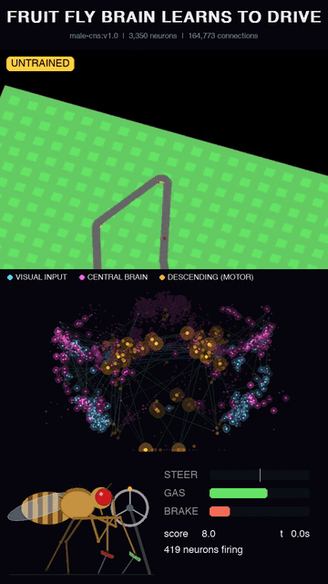
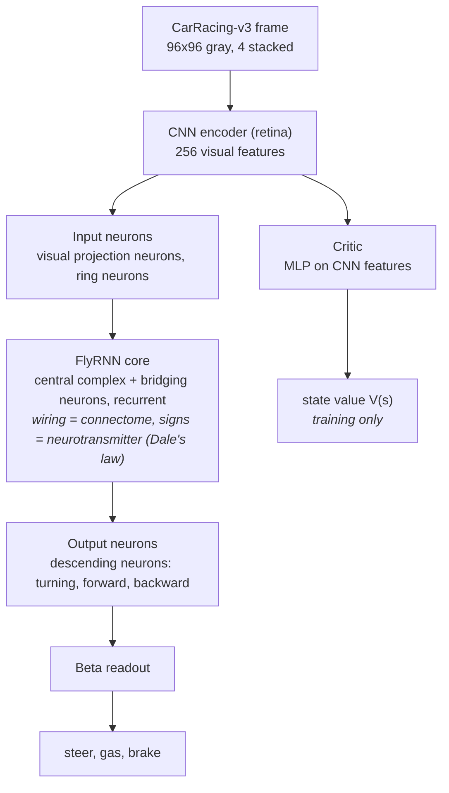
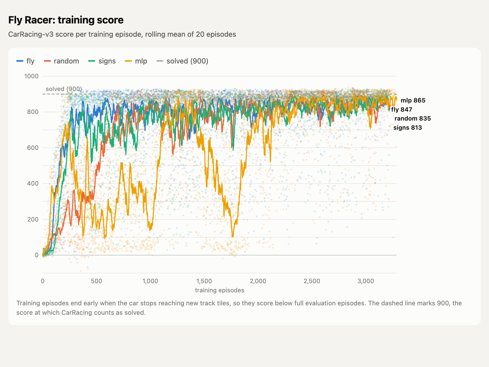
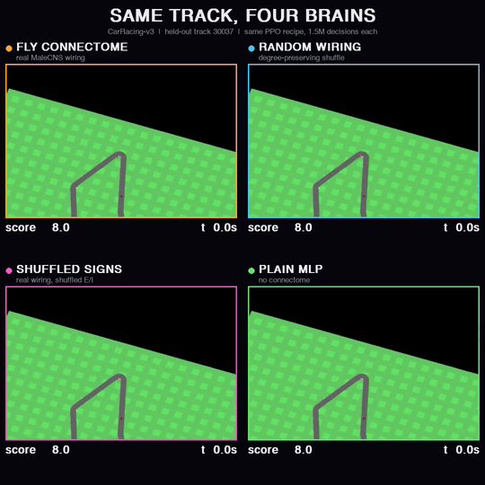

# Fly-Racer

A fruit fly brain learns to drive. The policy network is wired like a real fly's nervous system, taken from the MaleCNS v1.0 connectome (Janelia, Google Research, Cambridge; 166k+ neurons, brain plus nerve cord), and trained with PPO on Gymnasium `CarRacing-v3`. Everything runs locally on an Apple Silicon Mac.



## Architecture



Each neuron is a leaky rate unit, `v <- v + (dt/tau)(-v + W r + b + I)`, `r = tanh(relu(v))`. Per game frame the network settles for 6 steps from rest. Only real connectome edges exist and each keeps its presynaptic neuron's sign; training adjusts synapse strengths, time constants, biases and the visual input projection. The readout starts with a steering prior: right-side descending neurons steer right, left-side ones steer left.

The Tier S subgraph used here has 3,350 neurons (800 visual input, 2,430 central brain, 120 descending) and 164,773 connections.

To test whether the fly's specific wiring matters, the same pipeline trains control cores:

| Core | Wiring |
|---|---|
| `fly` | MaleCNS connectome subgraph |
| `random` | Degree-preserving shuffle of the same graph (same neuron count, degrees, E/I ratio) |
| `signs` | Real wiring, shuffled excitatory/inhibitory labels |
| `mlp` | Plain MLP, no connectome |

## Training recipe

PPO, CleanRL style, with these choices (all defaults in `flyracer/train.py`):

| Choice | Setting | Why |
|---|---|---|
| Action distribution | Beta per action in [0, 1] | Bounded like the controls, so no probability is wasted on clipped values; far more reliable driving than a clipped Gaussian |
| Augmentation | DrAC: policy and value agree on frames shifted by up to 4 px (weight 0.1) | The biggest single gain on unseen tracks |
| Update size | KL early stop at 0.02, 10 epochs, clip 0.2 | Keeps updates from undoing earlier learning |
| Control rate | A decision every 2 frames (25 per second) | Steering finely enough to hold speed through corners; laps get faster without leaving the road |
| Horizon | Discount 0.9975 per decision (about 0.995 per 4 frames), GAE 0.95 | Values finishing the lap, not just the next tile |
| Exploration | Entropy bonus 0.005 | Keeps trying faster lines |
| Learning rate | 3e-4, linear decay to 10% | |
| Episodes | Stall early-stop after 100 decisions (200 frames), reward normalization | Faster, cleaner training signal |
| Model selection | Evaluate 16 held-out tracks every 25 updates, keep `best.pt` | Scores swing between updates; this keeps the best policy |

## Setup

```bash
uv venv --python 3.12 .venv
uv pip install --python .venv/bin/python -e ".[dev]"
.venv/bin/python -m pytest -q
```

## Get the connectome (Tier S)

The extractor pulls a steering pathway from neuPrint dataset `male-cns:v1.0`: visual inputs, central complex, the strongest bridging neurons and descending neurons (see `configs/tier_s.yaml`).

1. Log in at https://neuprint.janelia.org, open Account, copy the auth token.
2. Put it in a `.env` file at the project root (gitignored):

```
NEUPRINT_APPLICATION_CREDENTIALS=<token>
```

3. Run:

```bash
.venv/bin/python -m flyracer.connectome.extract --config configs/tier_s.yaml
```

It prints how many neurons each cell type pattern matched and writes `data/tier_s.npz`. Without a connectome file, training falls back to a synthetic graph of the same shape, useful for testing the pipeline but not fly wiring.

## Train

```bash
.venv/bin/python -m flyracer.train --core fly --connectome data/tier_s.npz
.venv/bin/python -m flyracer.train --core random --connectome data/tier_s.npz
.venv/bin/python -m flyracer.train --core mlp
```

Runs write to `runs/<core>-<seed>/`: `progress.csv`, `episodes.csv`, `eval.csv`, checkpoints and `best.pt`. The default 1.5M decisions (3M game frames) take about 6 to 8 hours on an M4.

`--max-hours` saves the full training state to `resume.pt` and stops; `--resume` continues from it.

### On a Kaggle GPU

Demo notebook: [kaggle.com/code/supatroongpraiwan/fly-racer-train](https://www.kaggle.com/code/supatroongpraiwan/fly-racer-train). It clones this repo, installs Box2D, checks the fast renderer, trains on a T4 and plots the held-out scores.

The connectome is not included, because neuPrint requires a login. To run the notebook yourself:

1. Extract `data/tier_s.npz` as in [Get the connectome](#get-the-connectome-tier-s).
2. Upload it to Kaggle as a private dataset (Datasets, New Dataset). Upload the `.npz` file as it is.
3. Open the demo notebook and click Copy & Edit. In the side panel, use Add Input to attach your dataset, set Accelerator to GPU T4, and turn Internet on. Kaggle allows GPU and Internet only on phone-verified accounts.
4. Change the settings cell if you want (run name, `flyracer.train` arguments), then Save Version, Save & Run All.

The output keeps `runs/<name>/` with `best.pt`, checkpoints and logs.

Or start it from the command line, with the [kaggle CLI](https://github.com/Kaggle/kaggle-api) and a token in `~/.kaggle`:

```bash
git push   # the notebook clones the current commit from GitHub
python tools/kaggle/push.py --user <kaggle-user> --name fly-1 --args "--core fly --seed 1"
kaggle kernels output <kaggle-user>/fly-racer-train -p runs/kaggle   # when it finishes
```

The first push uploads `data/tier_s.npz` to your private dataset `<kaggle-user>/fly-racer-connectome`. Every push publishes the notebook `<kaggle-user>/fly-racer-train`, built from [tools/kaggle/train_notebook.py](tools/kaggle/train_notebook.py), and starts a run. Add `--private` to keep the notebook private. Kaggle stops a session after 12 hours, so training saves `resume.pt` at 11 hours. Continue the run with `--resume runs/<name>`, which uploads the run folder as the private dataset `<kaggle-user>/fly-racer-runs`.

Most of a CarRacing step is drawing the frame, so the environment is the bottleneck on Kaggle's 4 CPUs. `flyracer/fast_render.py` draws the same frames faster: polygon culling in numpy, a cached font, and no drawing of the repeated frame the agent never sees. A test checks its frames, rewards and episode ends against stock `CarRacing-v3`, and the notebook runs it before training.

| Measured on Kaggle (T4, 4 vCPUs) | Stock | This repo |
|---|---|---|
| Environment, 8 envs | 96 decisions/s | 281 decisions/s |
| PPO minibatch update | 55 ms | 41 ms |
| Full training run | about 66 decisions/s (estimated from the two rows above) | 129 decisions/s (1.5M in 3.2 hours) |

The Kaggle run `fly` seed 1 scored 888.8 +/- 26.4 on 100 held-out tracks (median 888.9, worst 744.4, 30 at 900+).

## Evaluate

```bash
.venv/bin/python -m flyracer.evaluate runs/fly-1/best.pt --episodes 24
.venv/bin/python -m flyracer.evaluate runs/fly-1/best.pt --episodes 100 --seed 30000
```

Full episodes, deterministic actions, on tracks never used in training.

## Watch and record

```bash
# live window
.venv/bin/python -m flyracer.watch --ckpt runs/fly-1/best.pt --live
# 9:16 reel: game, glowing brain activity, the fly at the wheel, steer/gas/brake
.venv/bin/python -m flyracer.watch --ckpt runs/fly-1/best.pt --record fly.mp4 --seed 26 --max-seconds 60
# learning progress montage, one clip per checkpoint
.venv/bin/python -m flyracer.watch --ckpt runs/fly-1/ckpt_*.pt --record progress.mp4 --max-seconds 8
# race up to four checkpoints side by side on the same track
.venv/bin/python -m flyracer.race --ckpt runs/fly-1/best.pt runs/random-1/best.pt runs/signs-1/best.pt runs/mlp-1/best.pt --seed 30037 --record race.mp4
```

## Plot training curves

```bash
.venv/bin/python -m flyracer.plot runs/fly-1 --out runs/training_curves.html --png
```

Writes a standalone interactive HTML chart (hover for values, data table, light and dark mode); `--png` also saves a 2x PNG via headless Chrome.

## Results



All four cores trained with the same recipe, one seed each. Lines show the rolling mean of 20 training episodes; dots are single episodes. Training episodes stop early when the car stalls, so they score below full evaluation episodes.

- **`fly`** learns fastest. It passes 800 within about 300 episodes and stays near there for the rest of training.
- **`signs`** (real wiring, shuffled excitatory/inhibitory labels) follows close behind but swings more in the first 1,000 episodes.
- **`random`** (shuffled wiring) starts slowest. It sits in the 100 to 400 range for the first 500 episodes and reaches the `fly` level only around episode 1,000.
- **`mlp`** (no connectome) is the least stable. It jumps to about 700 early, then collapses several times, falling as low as 100, and settles only after about 2,000 episodes.

By the end of training, all four score between 813 and 865, with `mlp` slightly ahead.





Each core's `best.pt`, scored on 100 full episodes on tracks never used in training (deterministic actions):

| Core | Mean score | Median | Worst episode | Episodes at 900+ |
|---|---|---|---|---|
| `fly` | **903.2 +/- 23.2** | 912.7 | **796.3** | 66 / 100 |
| `signs` | 896.9 +/- 28.2 | 904.0 | 745.0 | 57 / 100 |
| `mlp` | 894.0 +/- 75.9 | 911.1 | 351.2 | 63 / 100 |
| `random` | 883.7 +/- 82.0 | 909.7 | 430.9 | 63 / 100 |

CarRacing counts as solved at an average of 900 over 100 episodes; only `fly` clears it. Medians are close across all four, so the gap comes from bad episodes: `random` and `mlp` occasionally crash a track, while `fly` never drops below 796. On this evidence the fly's wiring makes learning faster and driving more consistent, though with one seed per core the differences in mean are small.


## License

The code is released under the [MIT License](LICENSE). The MaleCNS connectome is not included in this repository; it is downloaded from neuPrint and remains under its providers' terms.
