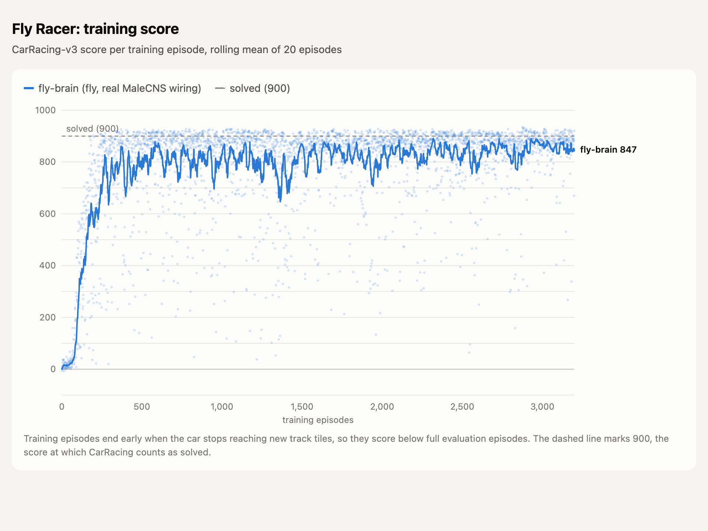

# fly-racer

A fruit fly brain learns to drive. The policy network is wired like a real fly's nervous system, taken from the MaleCNS v1.0 connectome (Janelia, Google Research, Cambridge; 166k+ neurons, brain plus nerve cord), and trained with PPO on Gymnasium `CarRacing-v3`. Everything runs locally on an Apple Silicon Mac.

## Architecture

```
CarRacing-v3 frame (96x96 gray, 4 stacked)
        |
        v
  CNN encoder ("retina")          256 visual features
        |
        v
  input neurons  (visual projection neurons, ring neurons)
        |
  FlyRNN core    (central complex + bridging neurons, recurrent)
        |          wiring = connectome, signs = neurotransmitter (Dale's law)
        v
  output neurons (descending neurons: turning, forward, backward)
        |
        v
  Beta readout -> steer, gas, brake        critic: MLP on CNN features
```

Each neuron is a leaky rate unit, `v <- v + (dt/tau)(-v + W r + b + I)`, `r = tanh(relu(v))`. Per game frame the network settles for 6 steps from rest. Only real connectome edges exist and each keeps its presynaptic neuron's sign; training adjusts synapse strengths, time constants, biases and the visual input projection. The readout starts with a steering prior: right-side descending neurons steer right, left-side ones steer left.

The Tier S subgraph used here has 3,350 neurons (800 visual input, 2,430 central brain, 120 descending) and 164,773 connections.

To test whether the fly's specific wiring matters, the same pipeline trains control cores:

| Core | Wiring |
|---|---|
| `fly` | MaleCNS connectome subgraph |
| `random` | Degree-preserving shuffle of the same graph (same neuron count, degrees, E/I ratio) |
| `signs` | Real wiring, shuffled excitatory/inhibitory labels |
| `mlp` | Plain MLP, no connectome |

## Training recipe

PPO, CleanRL style, with these choices (all defaults in `flyracer/train.py`):

| Choice | Setting | Why |
|---|---|---|
| Action distribution | Beta per action in [0, 1] | Bounded like the controls, so no probability is wasted on clipped values; far more reliable driving than a clipped Gaussian |
| Augmentation | DrAC: policy and value agree on frames shifted by up to 4 px (weight 0.1) | The biggest single gain on unseen tracks |
| Update size | KL early stop at 0.02, 10 epochs, clip 0.2 | Keeps updates from undoing earlier learning |
| Control rate | A decision every 2 frames (25 per second) | Steering finely enough to hold speed through corners; laps get faster without leaving the road |
| Horizon | Discount 0.9975 per decision (about 0.995 per 4 frames), GAE 0.95 | Values finishing the lap, not just the next tile |
| Exploration | Entropy bonus 0.005 | Keeps trying faster lines |
| Learning rate | 3e-4, linear decay to 10% | |
| Episodes | Stall early-stop after 100 decisions (200 frames), reward normalization | Faster, cleaner training signal |
| Model selection | Evaluate 16 held-out tracks every 25 updates, keep `best.pt` | Scores swing between updates; this keeps the best policy |

## Setup

```bash
uv venv --python 3.12 .venv
uv pip install --python .venv/bin/python -e ".[dev]"
.venv/bin/python -m pytest -q
```

## Get the connectome (Tier S)

The extractor pulls a steering pathway from neuPrint dataset `male-cns:v1.0`: visual inputs, central complex, the strongest bridging neurons and descending neurons (see `configs/tier_s.yaml`).

1. Log in at https://neuprint.janelia.org, open Account, copy the auth token.
2. Put it in a `.env` file at the project root (gitignored):

```
NEUPRINT_APPLICATION_CREDENTIALS=<token>
```

3. Run:

```bash
.venv/bin/python -m flyracer.connectome.extract --config configs/tier_s.yaml
```

It prints how many neurons each cell type pattern matched and writes `data/tier_s.npz`. Without a connectome file, training falls back to a synthetic graph of the same shape, useful for testing the pipeline but not fly wiring.

## Train

```bash
.venv/bin/python -m flyracer.train --core fly --connectome data/tier_s.npz
.venv/bin/python -m flyracer.train --core random --connectome data/tier_s.npz
.venv/bin/python -m flyracer.train --core mlp
```

Runs write to `runs/<core>-<seed>/`: `progress.csv`, `episodes.csv`, `eval.csv`, checkpoints and `best.pt`. The default 1.5M decisions (3M game frames) take about 6 to 8 hours on an M4.

## Evaluate

```bash
.venv/bin/python -m flyracer.evaluate runs/fly-1/best.pt --episodes 24
.venv/bin/python -m flyracer.evaluate runs/fly-1/best.pt --episodes 100 --seed 30000
```

Full episodes, deterministic actions, on tracks never used in training.

## Watch and record

```bash
# live window
.venv/bin/python -m flyracer.watch --ckpt runs/fly-1/best.pt --live
# 9:16 reel: game, glowing brain activity, the fly at the wheel, steer/gas/brake
.venv/bin/python -m flyracer.watch --ckpt runs/fly-1/best.pt --record fly.mp4 --seed 26 --max-seconds 60
# learning progress montage, one clip per checkpoint
.venv/bin/python -m flyracer.watch --ckpt runs/fly-1/ckpt_*.pt --record progress.mp4 --max-seconds 8
```

## Plot training curves

```bash
.venv/bin/python -m flyracer.plot runs/fly-1 --out runs/training_curves.html --png
```

Writes a standalone interactive HTML chart (hover for values, data table, light and dark mode); `--png` also saves a 2x PNG via headless Chrome.

## Results

One `fly` run on the real Tier S graph, seed 1, 1.5M decisions. The best checkpoint (1.08M decisions) was picked on the selection tracks, then scored once on each set of held-out tracks.

| Tracks | Episodes | Mean score |
|---|---|---|
| Selection (seeds 10000+) | 24 | 894.4 +/- 52.3 |
| Holdout (seeds 30000+) | 100 | 903.2 +/- 23.2 |
| Holdout, tracks 30000 to 30099 one at a time | 100 | 901.4 +/- 40.1 |
| Holdout, tracks 50000 to 50099 one at a time | 100 | 897.7 +/- 48.5 |
| All 300 holdout tracks | 300 | 900.8 |

CarRacing counts as solved at an average of 900 over 100 episodes, which the fly brain clears on unseen tracks.

Driving on tracks 30000 to 30099:

| Metric | Value |
|---|---|
| Median score | 915.5 |
| Laps finished within 20 s | 73 / 100 |
| Mean score of finished laps | 917.5 |
| Average lap time | 16.5 s |
| Track covered | 98.9% |

What limits the score: an episode ends after 1,000 frames (20 s) and every frame costs 0.1 points, so a finished lap scores about `1000 - 5 x lap seconds`. A 20 second lap scores exactly 900. The car stays on the road; the points it loses come from long tracks it cannot finish in 20 s, timing out with most of the track covered.



## Layout

| Path | Contents |
|---|---|
| `flyracer/connectome/` | File format, neuPrint extractor, synthetic graph, shuffle controls |
| `flyracer/models/` | FlyRNN and the actor-critic with the four cores |
| `flyracer/envs.py` | CarRacing wrappers |
| `flyracer/augment.py` | Random-shift augmentation for DrAC |
| `flyracer/train.py` | PPO trainer |
| `flyracer/evaluate.py`, `flyracer/checkpoint.py` | Evaluation on held-out tracks, checkpoint loading |
| `flyracer/viz/`, `flyracer/watch.py` | Reel dashboard, fly driver, live viewer, MP4 recorder |
| `flyracer/plot.py` | Training curve chart (HTML, PNG) |
| `configs/tier_s.yaml` | Tier S cell type selection |
